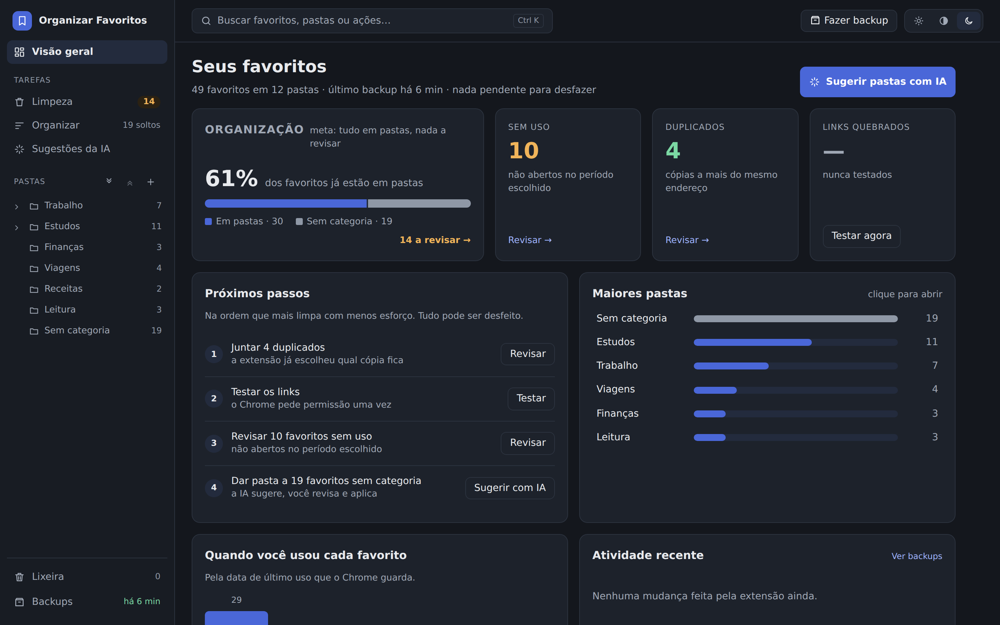
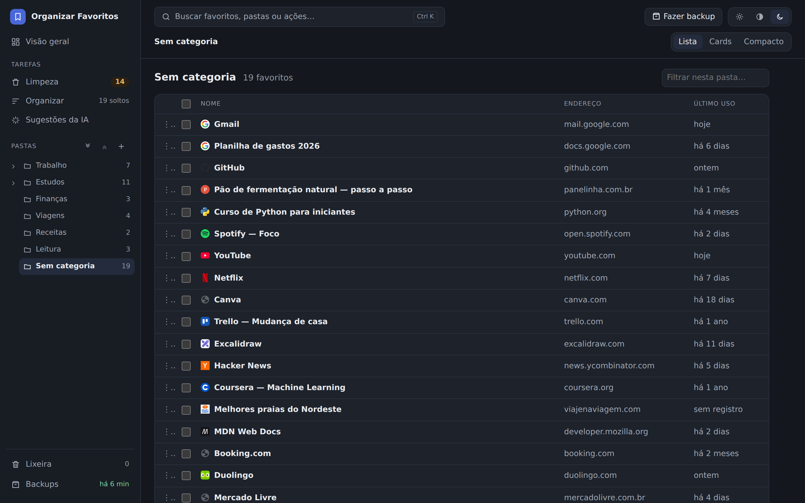
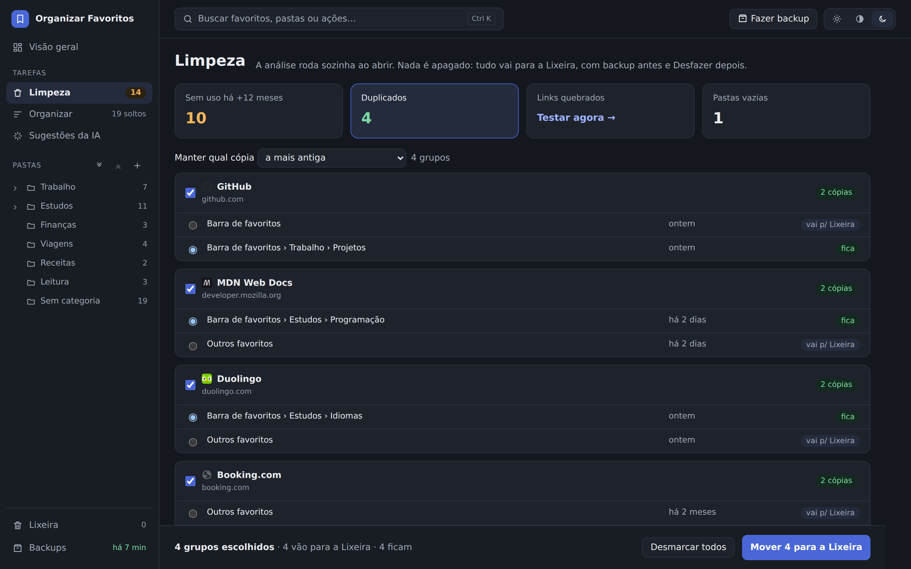
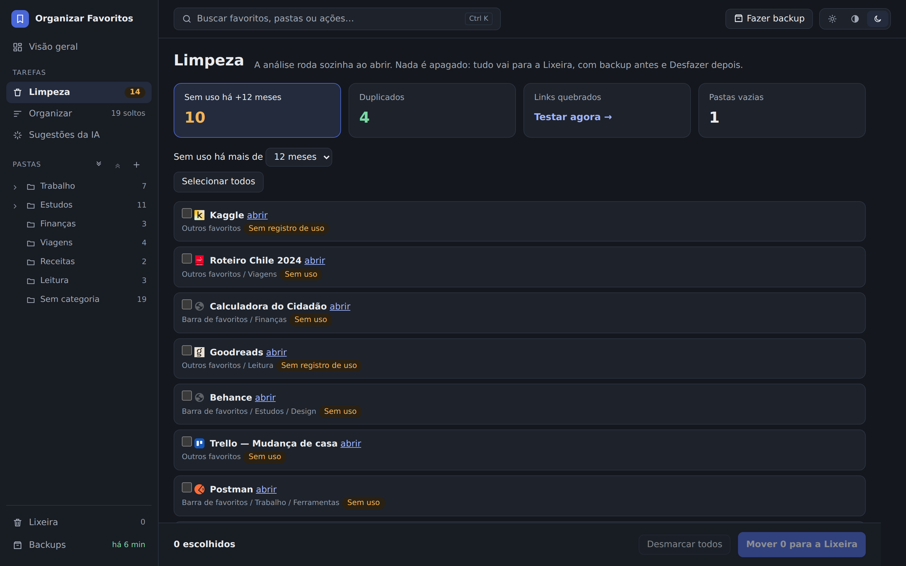
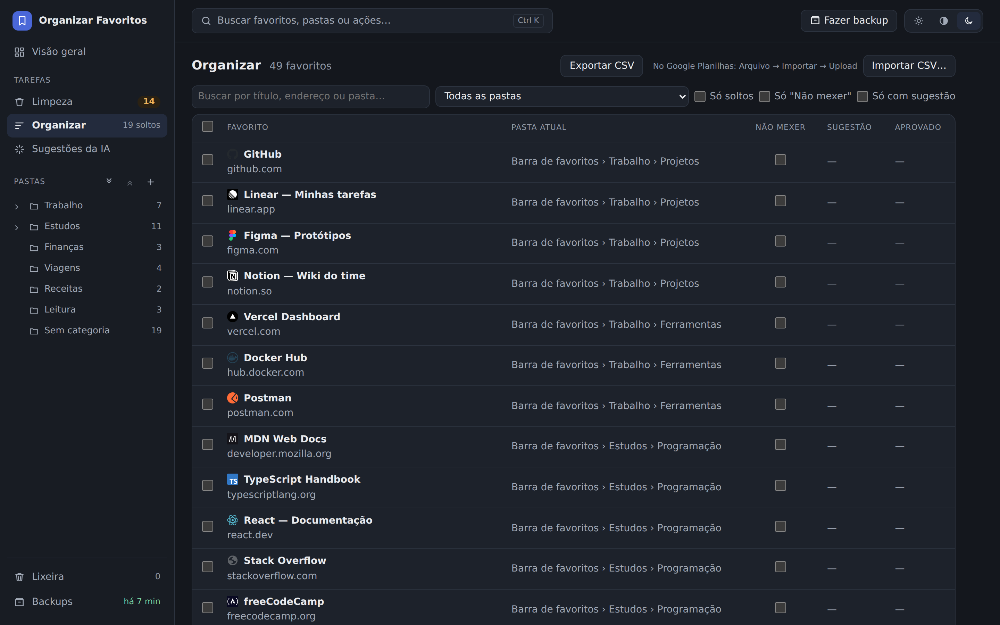
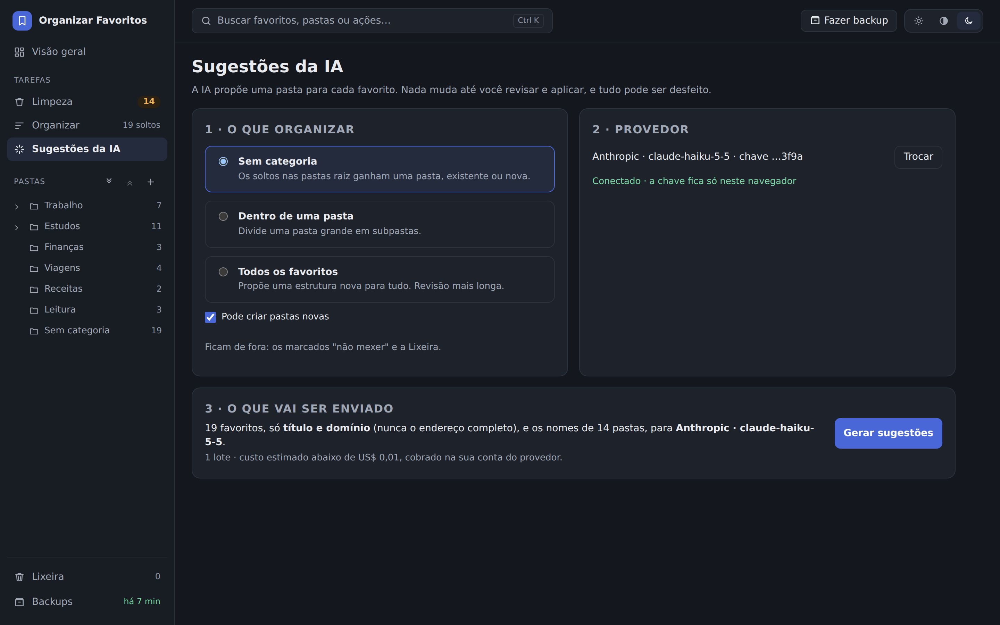
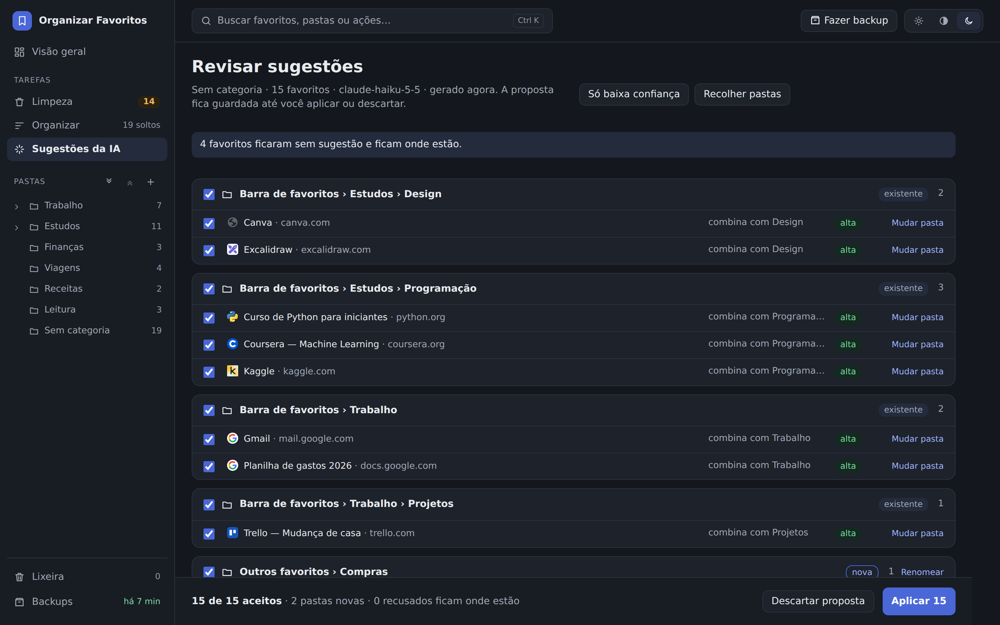
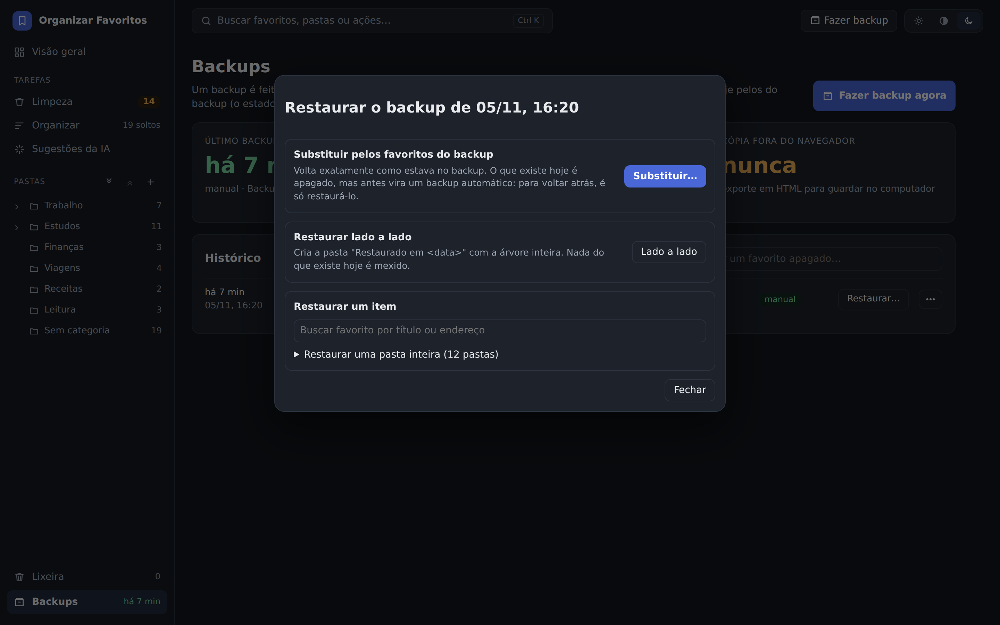
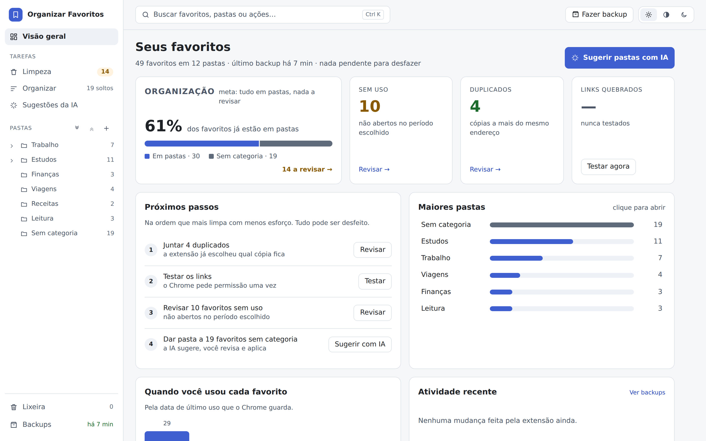
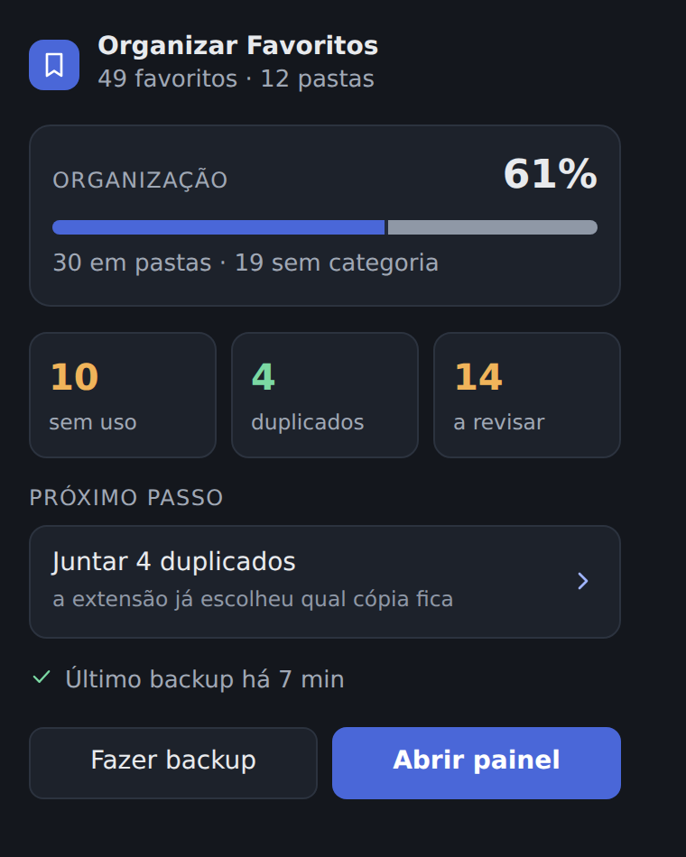

<div align="center">

# 🔖 Organizar Favoritos

**Limpe e organize os favoritos do Chrome sem medo de perder nada.**

Encontre favoritos esquecidos, duplicados e quebrados, coloque cada um na pasta certa (com ajuda de IA, se quiser) e volte atrás quando precisar: toda mudança tem pré-visualização, backup automático e Desfazer.


[Instalar](#-instalar) · [O que ela faz](#-o-que-ela-faz) · [Telas](#-telas) · [Privacidade](#-privacidade-e-permissões) · [Para desenvolvedores](#-para-desenvolvedores)



<sub>Todas as capturas usam favoritos fictícios.</sub>

</div>

---

## Por que existe

Com o tempo, a barra de favoritos vira uma gaveta: centenas de links soltos, cópias do mesmo site em pastas diferentes, páginas que não abrem mais e outras que você nunca mais visitou. O gerenciador do Chrome não ajuda a arrumar isso, e as extensões de limpeza costumam apagar coisas sem perguntar.

O **Organizar Favoritos** faz o contrário: mostra o que pode ser arrumado, deixa você revisar item por item e só então aplica, **sempre com um backup antes**.

## ✨ O que ela faz

| | |
|---|---|
| 📊 **Visão geral** | Quanto dos seus favoritos já está em pastas, quantos estão sem uso, duplicados ou quebrados, e os **próximos passos** em ordem. Cada número leva à tela que resolve aquilo. |
| 🧹 **Limpeza guiada** | Favoritos **sem uso** há mais de N meses, **duplicados** (mesmo endereço, mesmo com `utm_*` ou `#âncora` diferentes), **links quebrados** e **pastas vazias**. Nada é apagado: vai para uma Lixeira. |
| 🗂️ **Organizar** | Uma tabela com todos os favoritos e a pasta de cada um, com filtros e a marca **não mexer**. Nas listas das pastas, selecione vários ou arraste para mover. Exporta e importa a estrutura em **CSV** (abre no Google Planilhas). |
| ✨ **Sugestões com IA** | A IA propõe uma pasta para cada favorito solto. Você revisa, ajusta e aplica só o que quiser. Funciona com a **Anthropic (Claude)** ou qualquer API **compatível com OpenAI** (OpenAI, Gemini, Groq, OpenRouter, Ollama). |
| 🛟 **Backups e restauração** | Backup automático antes de cada mudança, backup manual quando quiser, exportação em HTML ou JSON e restauração completa, lado a lado ou de um item só. |
| 🔎 **Busca rápida** | `Ctrl + K` busca favoritos, pastas e ações de qualquer tela. |
| 🎨 **Detalhes** | Ícone de cada site (do cache do próprio Chrome), tema claro, escuro ou do sistema, e um popup com o resumo no ícone da extensão. |

## 📸 Telas

### Seus favoritos, com o ícone de cada site



### Limpeza: duplicados e sem uso

A extensão já escolhe qual cópia de cada duplicado fica (a mais antiga, a da pasta mais específica ou a mais usada) e você pode trocar.





### Organizar



### Sugestões da IA

Antes de enviar, a tela mostra exatamente o que sai do navegador e quanto deve custar. Depois, as sugestões aparecem agrupadas por pasta, com o motivo e a confiança de cada uma.





### Restaurar um backup



### Tema claro e popup

<table>
  <tr>
    <td width="72%"></td>
    <td width="28%"></td>
  </tr>
</table>

---

## 📥 Instalar

A extensão ainda não está na Chrome Web Store: por enquanto, você gera o build no seu computador e carrega a pasta no Chrome. Precisa do [Node.js](https://nodejs.org) (desenvolvido com a versão 24) e do [Git](https://git-scm.com).

1. No terminal, baixe o projeto e gere o build:

   ```bash
   git clone https://github.com/GustavoWalien/organizar-favoritos.git
   cd organizar-favoritos
   npm install
   npm run build
   ```

2. No Chrome, abra `chrome://extensions`.
3. Ligue o **Modo do desenvolvedor**, no canto superior direito.
4. Clique em **Carregar sem compactação** e escolha a pasta `.output/chrome-mv3`, dentro do projeto. Não apague nem mova essa pasta depois.
5. Fixe o ícone 🔖 na barra do Chrome e clique nele para abrir o painel.

> Feita e testada no Chrome. Por usar as mesmas APIs, deve funcionar em navegadores baseados nele, como Edge e Brave.

### Primeiros passos

1. **Faça um backup** pelo botão no topo do painel (a extensão também faz um sozinha antes de cada mudança).
2. Siga os **Próximos passos** da Visão geral: juntar duplicados, testar os links, revisar os sem uso.
3. Para dar pasta aos favoritos soltos, use **Sugestões da IA** ou arraste-os para uma pasta na barra lateral.
4. Errou? Clique em **Desfazer** no aviso, ou restaure um backup em **Backups**.

### Usando a IA

A IA é opcional. Para usar, você precisa de uma **chave de API** do provedor. Assinaturas como ChatGPT Plus ou Claude Pro não servem, porque não dão acesso à API.

- **Anthropic:** crie a chave em [console.anthropic.com](https://console.anthropic.com), em *Settings → API Keys*, e coloque créditos em *Billing*. O modelo padrão é o **Claude Haiku 5.5**, o mais barato: pela estimativa da própria extensão, organizar mil favoritos custa alguns centavos de dólar.
- **Compatível com OpenAI:** informe o endereço da API, a chave e o modelo. O endereço precisa ser `https://`; `http://` só é aceito na sua máquina ou rede local (Ollama, por exemplo).

A chave fica guardada só no armazenamento local deste navegador, sem criptografia: ela não vai nos backups nem na sincronização do Chrome, mas quem tiver acesso ao seu perfil do Chrome consegue lê-la. Dá para apagá-la a qualquer momento em **Remover chave**. Use uma chave só para isso e defina um limite de gasto no console do provedor. A cobrança vem na sua conta do provedor.

## 🔒 Privacidade e permissões

- **A extensão não envia seus favoritos para nenhum servidor.** Não há conta, servidor próprio nem rastreamento. (A sincronização do Chrome, se estiver ligada, continua funcionando como sempre.)
- A única exceção é a IA, e só quando você clica em **Gerar sugestões**: vão o **título e o domínio** de cada favorito (nunca o endereço completo) e os nomes das pastas, direto para o provedor que você escolheu.
- O teste de links acessa os sites só quando você pede e com a sua permissão, sem enviar seus cookies ou logins.

| Permissão | Para quê |
|---|---|
| `bookmarks` | Ler e reorganizar os favoritos |
| `storage`, `unlimitedStorage` | Guardar backups e preferências no navegador |
| `favicon` | Mostrar o ícone de cada site a partir do cache do Chrome |
| Acesso a sites (opcional) | Pedido só ao clicar em **Testar links**, ou no domínio do provedor de IA ao clicar em **Testar conexão** |

> O Chrome sincroniza favoritos entre dispositivos: o que for reorganizado aqui chega aos outros. Os backups são a sua rede de proteção.

---

## 💻 Para desenvolvedores

### Stack

- **[WXT](https://wxt.dev)**, framework de extensões com Vite, gerando um Manifest V3
- **React 19** e **TypeScript** (modo estrito)
- **IndexedDB** (`idb`) para backups e o histórico do Desfazer
- **`@anthropic-ai/sdk`** com saída estruturada (JSON Schema), e `fetch` para as APIs compatíveis com OpenAI
- **Vitest** e `fake-indexeddb`: **475 testes**, quase todos da lógica, sem precisar do Chrome

### Rodando localmente

Siga os passos de [Instalar](#-instalar). Depois de cada build, clique em recarregar na extensão, em `chrome://extensions`.

| Comando | Para quê |
|---|---|
| `npm run dev` | Modo de desenvolvimento do WXT, com recarga automática |
| `npm run build` | Build de produção |
| `npm test` | Testes (Vitest) |
| `npm run compile` | Checagem de tipos (`tsc --noEmit`) |
| `npm run zip` | Gera o `.zip` para distribuir |

> **Chrome no Windows e código no WSL?** Carregue a pasta pelo caminho `\\wsl.localhost\<distro>\...\organizar-favoritos\.output\chrome-mv3`. Detalhes em [`docs/decisions/0000-stack.md`](docs/decisions/0000-stack.md).

### Como funciona por dentro

Nenhuma tela mexe nos favoritos diretamente. Toda alteração vira um **plano**:

```
calcular o plano → pré-visualizar → backup → aplicar → guardar o inverso (Desfazer)
```

- Um **plano** é uma lista de operações (`create-folder`, `create-link`, `move`, `remove`) calculada sem tocar no Chrome.
- O `runPlan` grava um backup e, **se o backup falhar, não aplica nada**. Depois aplica as operações uma a uma (uma falha isolada não derruba as outras) e registra o inverso de cada uma para o Desfazer.
- A lógica fica em `src/core/`, sem depender do Chrome. O acesso aos favoritos passa pela interface `BookmarksApi`, e os testes usam uma versão falsa em memória.

```
src/
  core/          lógica pura e testada: planos, duplicados, links, limpeza, restauração, CSV
  ai/            escopo, prompt, validação da resposta e adaptadores (Anthropic, compatível com OpenAI)
  chrome/        adaptadores finos para as APIs do Chrome
  storage/       IndexedDB e chrome.storage: backups, histórico do Desfazer, preferências
  ui/            componentes React, telas e tema
  entrypoints/   páginas da extensão: painel e popup
tests/           testes (Vitest)
docs/            decisões de design, planos e specs
```

### Decisões de design

- **Reversibilidade acima de tudo:** é melhor pedir uma confirmação a mais do que perder um favorito.
- **"Incerto" em vez de "quebrado":** só 404 e 410 contam como quebrado. Timeout, bloqueio, 401/403/429 e 5xx viram "incerto" e nunca vêm marcados para a Lixeira.
- **Sem service worker:** o teste de links roda na página do painel, porque o Chrome pode encerrar o service worker no meio de uma varredura longa.
- **ID fixo da extensão:** o manifesto tem uma `key` pública, para os backups (atrelados ao ID) não se perderem se a pasta do build mudar.
- **A IA nunca aplica sozinha:** ela devolve uma proposta validada contra um esquema, e só o que você aceita vira plano.
- **Importar CSV só cria e move:** nunca apaga nem renomeia o que já existe.

O design completo e a pesquisa de soluções existentes estão em [`PLANO.md`](PLANO.md) e em [`docs/`](docs/).

---

## 🗺️ Roadmap

- [x] Backups, exportação e restauração
- [x] Limpeza: sem uso, duplicados, links quebrados e pastas vazias
- [x] Vista Organizar, marca "não mexer" e CSV da estrutura
- [x] Sugestões de pastas com IA
- [x] Painel redesenhado, popup e ícones dos sites
- [ ] Sugestões da IA que aprendem com exemplos da sua própria organização
- [ ] Publicação na Chrome Web Store
- [ ] CI com testes e build a cada push

## 📄 Licença

[MIT](LICENSE). Feito por [Gustavo Silva](https://github.com/GustavoWalien).

<details>
<summary><b>English summary</b></summary>

**Organizar Favoritos** is a Chrome extension (Manifest V3, React 19, TypeScript, WXT) that helps you clean up and organize your bookmarks safely. It finds unused, duplicate and broken bookmarks and empty folders, lets you review everything before applying, and moves items to a Trash folder instead of deleting them. An optional AI assistant (Anthropic or any OpenAI-compatible API, with your own key) suggests a folder for each loose bookmark; you review and apply only what you accept. Every change is a computed *plan* that runs only after an automatic backup succeeds, and keeps an undo journal. The extension sends your bookmarks to no server of its own; only titles and domains go to the AI provider, and only when you explicitly ask for suggestions. The core logic is framework-free and covered by 475 Vitest tests.

</details>
